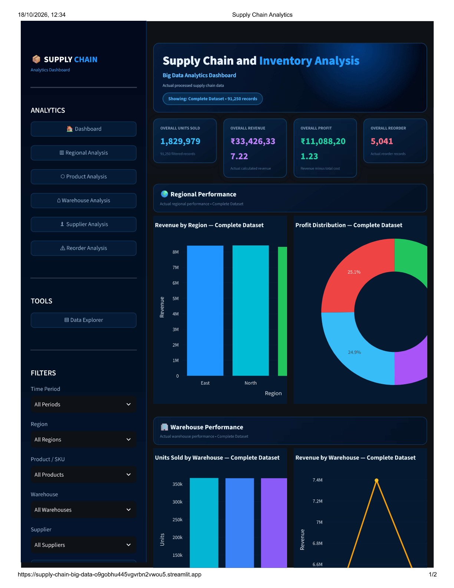
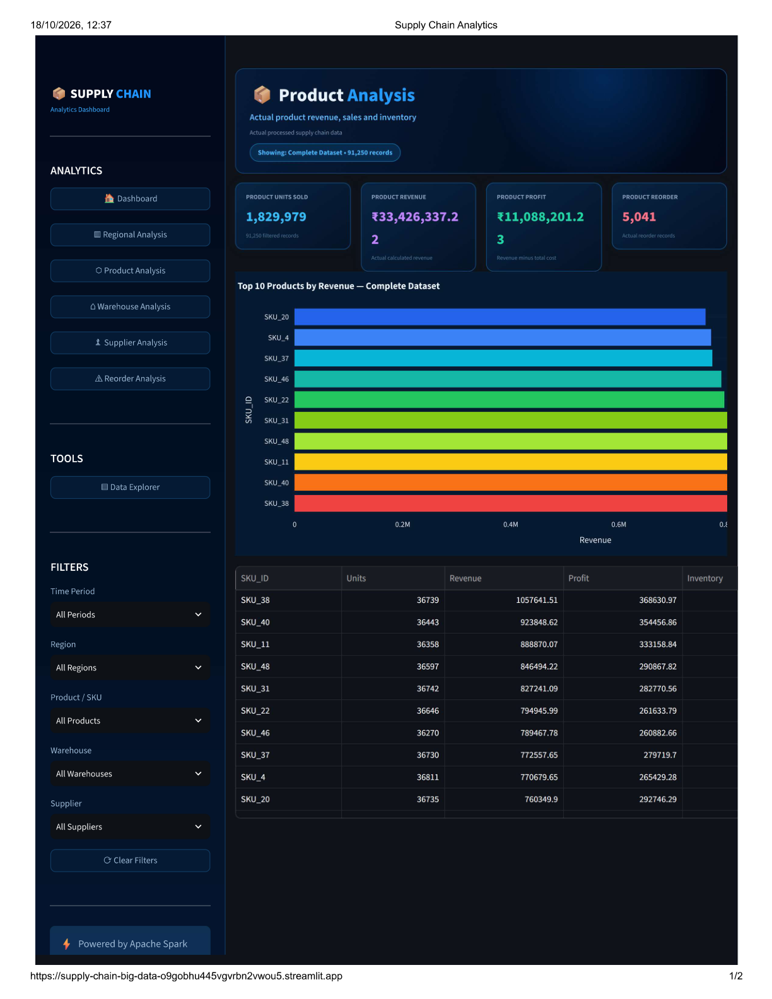
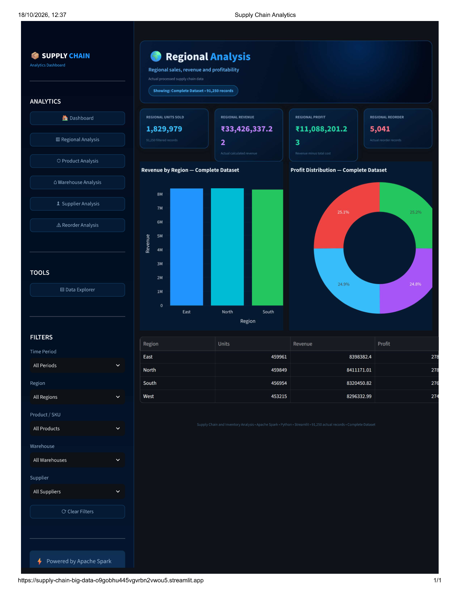
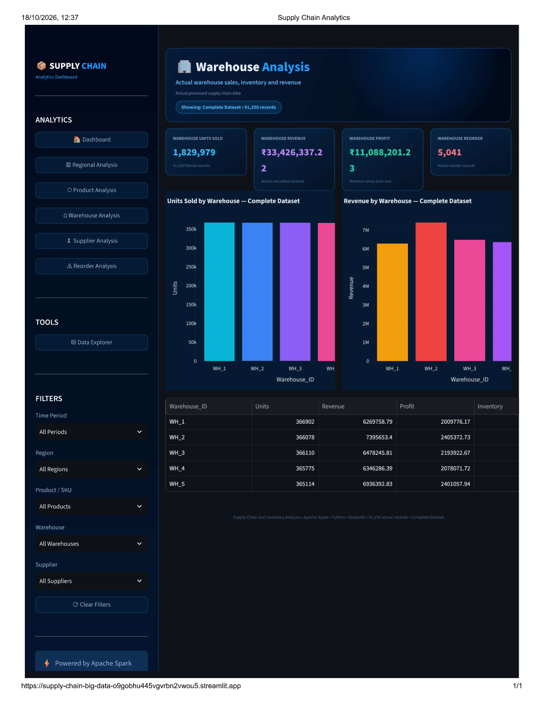
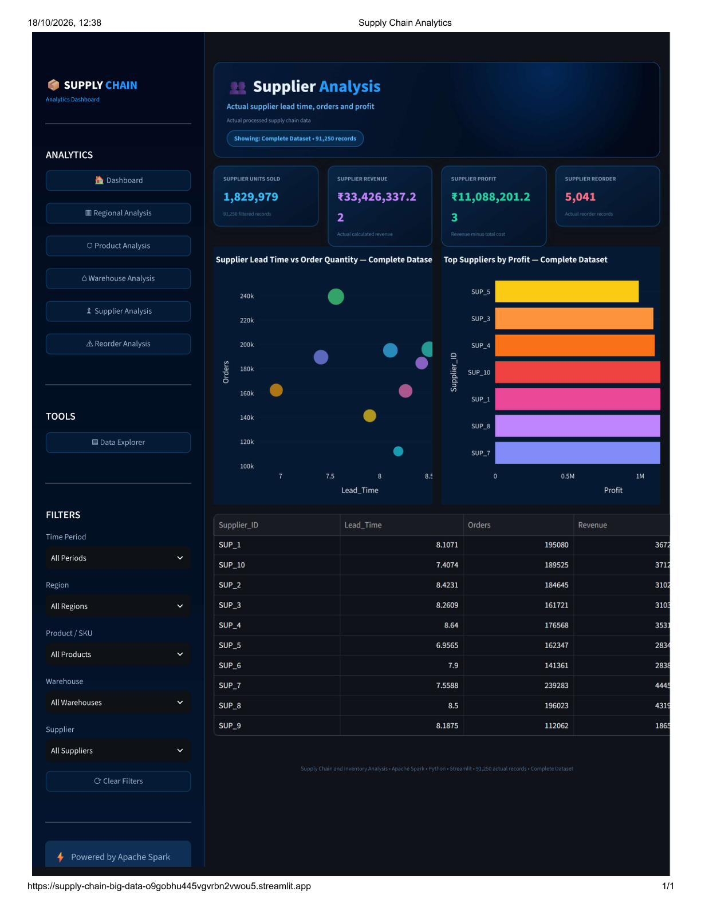
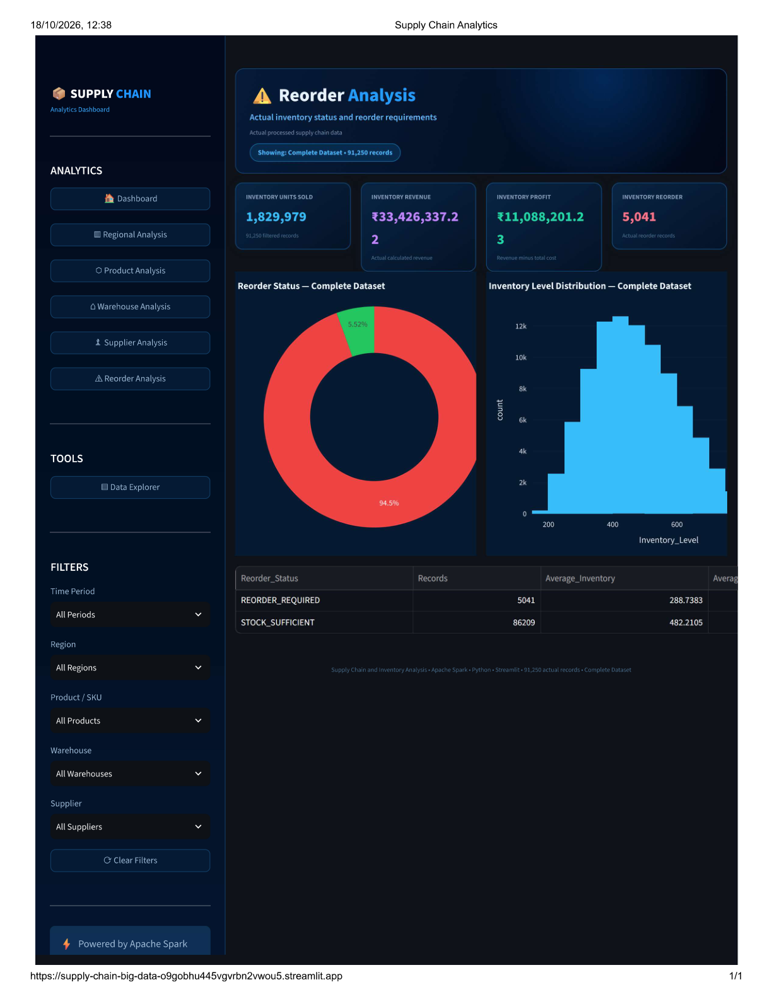

# Supply Chain and Inventory Analysis Using Big Data Analytics

> A PySpark and Spark SQL pipeline for analyzing products, warehouses, suppliers, regional performance, and inventory reorder requirements, supported by an interactive Streamlit dashboard.

**Live Demo:** [Open the Streamlit Dashboard](https://supply-chain-big-data-o9gobhu445vgvrbn2wvou5.streamlit.app)

**GitHub Repository:** [Supply-Chain-Big-Data](https://github.com/anvitharv-create/Supply-Chain-Big-Data)

## Business Problem

Supply chain and inventory operations require effective monitoring of sales, inventory levels, supplier activity, and replenishment needs. Without proper analysis, businesses may struggle to identify inventory that requires reordering or understand differences in product, warehouse, and regional performance.

This project uses PySpark, Spark SQL, and data visualization to transform supply chain inventory data into useful analytical insights. It identifies records requiring reordering and helps explore revenue, profitability, supplier activity, and regional performance.

## Key Insights

- **Records requiring reorder:** 5,041 records were classified as `REORDER_REQUIRED`.
- **Stock sufficient:** 86,209 records were classified as `STOCK_SUFFICIENT`.
- **Top-revenue product:** SKU_38, with revenue of ₹1,057,641.51 and profit of ₹368,630.97.
- **Top-revenue warehouse:** WH_2, with revenue of ₹7,395,653.40.
- **Supplier with the highest order quantity:** SUP_7, with an order quantity of 239,283 and an average lead time of 7.56 days.
- **Top-revenue region:** North, with revenue of ₹8,411,171.01.

**Recommendation:** Use the reorder analysis to review replenishment needs, and investigate high-revenue products and regional performance when planning inventory allocation.

*These findings are based on the supplied synthetic dataset. The dataset contains no positive stockout events, so the project does not claim to measure actual stockout reduction.*

## Dashboard
## Dashboard Screenshots

### Dashboard Overview


### Product Analysis


### Regional Analysis


### Warehouse Analysis


### Supplier Analysis


### Reorder Analysis


**[Open the Live Dashboard](https://supply-chain-big-data-o9gobhu445vgvrbn2wvou5.streamlit.app/)**

The interactive Streamlit dashboard includes:

- **Dashboard:** Key performance indicators and an overview of supply chain data.
- **Product Analysis:** Product-level revenue and profitability.
- **Warehouse Analysis:** Comparison of warehouse performance.
- **Supplier Analysis:** Supplier-related metrics and comparisons.
- **Regional Analysis:** Regional revenue and performance.
- **Reorder Analysis:** Inventory records grouped by reorder status.
- **Data Explorer:** Interactive exploration of processed data.

**Live Dashboard:** [View the Dashboard](https://supply-chain-big-data-o9gobhu445vgvrbn2wvou5.streamlit.app)

*Dashboard screenshots can be added after uploading actual screenshots to the repository.*

## What This Project Delivers

- **Data ingestion:** Loads raw CSV data into PySpark DataFrames.
- **Data validation:** Checks missing values, duplicates, and invalid records.
- **Feature engineering:** Creates `Revenue`, `Total_Cost`, `Profit`, `Inventory_Value`, `Demand_Variance`, `Reorder_Status`, and `Stock_Level_Category`.
- **Storage:** Saves processed data in Parquet format.
- **Product analysis:** Examines product-level revenue and profitability.
- **Warehouse analysis:** Compares warehouse performance.
- **Supplier analysis:** Examines supplier order quantities, lead times, and associated metrics.
- **Regional analysis:** Compares regional revenue.
- **Reorder analysis:** Classifies records according to reorder requirements.
- **Spark SQL:** Performs analytical queries on the processed data.
- **Dashboard:** Presents results using Streamlit and Plotly visualizations.

## Tech Stack

| Technology | Purpose |
|---|---|
| Python 3.12 | Core programming language |
| PySpark 4.2.0 | Data processing and transformation |
| Spark SQL | Analytical queries |
| Parquet | Processed data storage |
| Pandas | Dashboard data handling |
| Streamlit 1.64.0 | Interactive dashboard |
| Plotly 6.5.0 | Interactive visualizations |
| Git and GitHub | Version control and project hosting |

**Environment:** Python 3.12 and Java 25.0.2 were used in the development environment. Local Windows execution may require Hadoop native utilities to be configured for Spark.

## Dataset

- **Source:** [High-Dimensional Supply Chain Inventory Dataset – Kaggle](https://www.kaggle.com/datasets/ziya07/high-dimensional-supply-chain-inventory-dataset)
- **Raw file:** `supply_chain_dataset1.csv`
- **Records:** 91,250
- **Original columns:** 15
- **Missing values:** 0
- **Duplicate records:** 0
- **Invalid records identified during validation:** 0
- **Data type:** Synthetic supply chain and inventory data.

Key fields include `Date`, `SKU_ID`, `Warehouse_ID`, `Supplier_ID`, `Region`, `Units_Sold`, `Inventory_Level`, `Supplier_Lead_Time_Days`, `Reorder_Point`, `Order_Quantity`, `Unit_Cost`, `Unit_Price`, `Promotion_Flag`, `Stockout_Flag`, and `Demand_Forecast`.

The dataset is medium-sized. PySpark demonstrates a distributed data-processing approach that can be adapted to larger datasets, but large-scale performance has not been benchmarked in this project.

## Project Workflow

```text
Raw CSV Dataset
       ↓
Data Ingestion Using PySpark
       ↓
Data Validation
       ↓
Feature Engineering
       ↓
Parquet Storage
       ↓
PySpark Analysis
       ↓
Spark SQL Analysis
       ↓
Dashboard Data Preparation
       ↓
Interactive Streamlit Dashboard
```

**Why Parquet?**

Parquet is a columnar storage format that supports compression and efficient column-based data access. The project stores processed data in Parquet format for subsequent analytical operations.

## Sample Spark SQL Queries

The following examples use the project's actual field names. They assume the processed dataset has been registered as a Spark SQL temporary view named `supply_chain`.

**Records requiring reorder**

```sql
SELECT SKU_ID,
       Warehouse_ID,
       Inventory_Level,
       Reorder_Point,
       Reorder_Status
FROM supply_chain
WHERE Reorder_Status = 'REORDER_REQUIRED'
ORDER BY Inventory_Level ASC;
```

**Supplier performance summary**

```sql
SELECT Supplier_ID,
       SUM(Order_Quantity) AS Total_Order_Quantity,
       AVG(Supplier_Lead_Time_Days) AS Average_Lead_Time,
       SUM(Profit) AS Total_Profit
FROM supply_chain
GROUP BY Supplier_ID
ORDER BY Average_Lead_Time DESC;
```

These queries demonstrate how the processed dataset can be explored using Spark SQL. The temporary view must be created by the application or analysis script before executing them.

## Project Structure

```text
Supply-Chain-Big-Data/
├── dashboard/
│   └── app.py
├── data/
│   ├── raw/
│   │   └── supply_chain_dataset1.csv
│   ├── processed/
│   │   └── supply_chain_processed/
│   └── dashboard/
├── docs/
├── notebooks/
├── output/
├── sql/
│   ├── product_analysis.sql
│   ├── warehouse_analysis.sql
│   ├── supplier_analysis.sql
│   └── regional_analysis.sql
├── src/
│   ├── spark_test.py
│   ├── data_ingestion.py
│   ├── data_validation.py
│   ├── feature_engineering.py
│   ├── analytics.py
│   ├── sql_analysis.py
│   └── export_dashboard_data.py
├── requirements.txt
├── .gitignore
└── README.md
```

## How to Run

### 1. Clone the repository

```bash
git clone https://github.com/anvitharv-create/Supply-Chain-Big-Data.git
cd Supply-Chain-Big-Data
```

### 2. Create a virtual environment

```bash
python -m venv .venv
```

### 3. Activate the environment

For Windows PowerShell:

```powershell
.\.venv\Scripts\Activate.ps1
```

### 4. Install dependencies

```bash
python -m pip install -r requirements.txt
```

### 5. Run the processing pipeline

Run the scripts from the project root in the order required by their input and output dependencies:

```bash
python src/spark_test.py
python src/data_ingestion.py
python src/data_validation.py
python src/feature_engineering.py
python src/analytics.py
python src/sql_analysis.py
python src/export_dashboard_data.py
```

### 6. Launch the dashboard

```bash
streamlit run dashboard/app.py
```

Ensure Java is installed and correctly configured for PySpark. On Windows, configure any required Hadoop native utilities according to your local Spark environment.

## Limitations

- The dataset is synthetic and contains 91,250 records, rather than a massive production-scale dataset.
- The analysis is descriptive; a trained demand forecasting model is not included.
- `Stockout_Flag` has no positive cases, limiting analysis of actual stockout events.
- Reorder classifications depend on the project's implemented rules and dataset fields.
- Results represent the supplied dataset and should not be interpreted as verified real-world business performance.

## Future Improvements

- Develop and evaluate demand forecasting models.
- Add inventory optimization and automated reorder recommendations.
- Test the pipeline on larger datasets and distributed environments.
- Add more detailed supplier reliability metrics when appropriate data is available.
- Introduce automated data quality tests and scheduled data refreshes.

## Conclusion

This project demonstrates a complete analytical workflow using PySpark, Spark SQL, Parquet, and Streamlit. It transforms raw supply chain data into analytical features, examines product and operational performance, identifies reorder requirements, and presents results through an interactive dashboard.

The project provides practical experience in big data processing, data validation, feature engineering, SQL analytics, and dashboard development.

## Author

**Anvitha R V**  
Final-Year Student, Information Science and Engineering

GitHub: [anvitharv-create](https://github.com/anvitharv-create)
